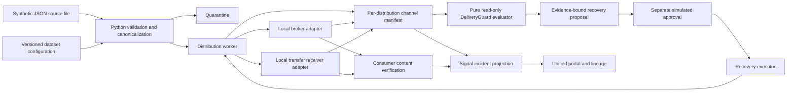

# DeliveryGuard + Signal — architecture review and hackathon demonstration

## Decision requested

Accept the architecture direction for a scoped internal sandbox evaluation, conditional on validating the real adapters, identity controls, operational storage and failure semantics. This demonstration does not request production approval. A manager's decision is a human outcome, not a status the software can confer.

## Consolidated scope from the two screenshots

The supplied screenshots describe an inbound-file-to-Kafka/MFTS POC, a deterministic read-only delivery-risk advisor, a Signal investigation app, and a unified portal. Key requirements are stable distribution identities, per-channel manifests, controlled retry/reconciliation, quarantine, deadlines, consumer impact, explainable recommendations and evidence fingerprints. Kafka success must not be replayed merely to recover MFTS. Configuration references alone are not approvals. Delivery is at-least-once with explicit idempotency boundaries, not end-to-end exactly-once.

The external workspace and its named modules have not been imported or inspected. This repo implements an independent local vertical slice from that consolidated scope. Its payment-authorization example remains out of scope; there is no fraud scoring, payment decision, or critical-path model call. No LLM is used by the runtime.

## Business story and differentiation

A treasury data product is delivered to two downstream consumers through Kafka and a required transfer channel. Kafka has acknowledged five records, while the transfer channel fails and the delivery deadline elapses. Operators need to know what actually completed, who is exposed and what can safely be retried. DeliveryGuard recommends MFTS-only recovery. An operator requests it; a different simulated approver authorizes the evidence-bound proposal; an executor resumes MFTS. Five Kafka writes remain five. Receiver-content checks then verify both consumers and the linked Signal graph turns green.

The differentiator to evaluate is recovery precision across delivery channels with verifiable evidence, rather than a generic data-quality dashboard or a promise of AI diagnosis. No competitive superiority is established by this demo.

## Runtime architecture

The Flask service is the control surface. Python modules execute ingestion, delivery, approval gates, retries, reconciliation and verification. SQLite persists the request, manifest, adapter ledger, audit trail and Signal projection. A single SQLite transaction commits canonical request state, audit evidence and the Signal projection, so the demo is not a collection of disconnected browser fixtures. GET endpoints do not mutate pipeline state.

## What is real, synthetic and future

| Component | Implementation in this repo | Boundary |
|---|---|---|
| File ingestion | Reads a real JSON fixture from disk | File contents and arrival request are synthetic; no bucket watcher |
| Validation / routing | Executes Python, Decimal validation, identity hashing, quarantine and route lookup | Demonstration contract, not payment validation |
| Delivery worker | Executes channel writes, tracks attempts and applies replay suppression | Local synchronous worker, not Spark or a distributed scheduler |
| Kafka boundary | LocalBroker appends accepted key/payload/topic/offset entries | No real broker, partition ownership, transactions or ACLs |
| MFTS boundary | LocalTransfer writes identity-keyed artifacts to a persisted receiver map | No real SFTP/MFTS server, network or external receipt; artifacts are record envelopes, not a production batch-file format |
| Persistence | SQLite transactions and serialized JSON state | Not a benchmark or replacement for production operational storage |
| Advisor | Pure, deterministic evaluation of observed state | No external reads, recovery writes or model inference |
| Approval | Request → approve → execute; distinct simulated names and evidence hash | Local demonstration identities, not enterprise RBAC or maker/checker enforcement |
| Recovery | Executes approved local retry/reconcile operation | No arbitrary code execution and no actual Kafka/MFTS action |
| Consumers | Compares local receiver payloads against expected canonical contents | Not an external report refresh or proof of business correctness |
| Signal integration | Same-run evidence projected into persisted Signal incidents and lineage | Delivery Lab is enabled only in local demo mode |
| Existing Databricks connector | Separate Jobs/SQL/lineage integration from the original pilot | Not invoked by the synthetic delivery engine; live validation remains outstanding |
| Target platform | Adapter and storage migration described below | Not deployed or certified by this demo |

## Contracts and state transitions

- Source fields: source_record_id, route_key, amount and currency. All fixture identities are SYN-prefixed.
- processing_id = SHA-256(dataset + source_record_id).
- distribution_id = SHA-256(processing_id + route_key); used as the local Kafka key and transfer artifact ID.
- Payload fingerprints distinguish an identical duplicate from conflicting content for the same identity. Conflicts go to quarantine.
- Each simulation has an independent execution universe. Broker ledgers are per run; cross-request/global exactly-once processing is not claimed. Replaying the same request skips successful manifest entries.
- Request key derives from file fingerprint, dataset and configuration revision. Execution IDs are unique for independent experiments; arrival deduplication across separate experiments is not implemented.
- Stage: CREATED → VALIDATED → DISTRIBUTED, with a STALLED fault branch.
- Channel states: PENDING, SUCCEEDED, FAILED, UNKNOWN, DEFERRED. UNKNOWN requires reconciliation before retry; a missing acknowledgment is not treated as proof of non-delivery.
- Advisor statuses: BLOCKED, BREACHED, AT_RISK, ON_TRACK. A required-channel failure cannot be ignored because the pipeline job succeeded.
- Configurations are content-addressed, append-only revisions; each request freezes its selected revision. There is no enterprise configuration approval service in this demo.

## Recovery safety and evidence

The evaluator returns a SHA-256 fingerprint of the operational evidence it used. A proposal is bound to that fingerprint and an allowed recommendation. Approval requires a different simulated actor from the requester. Execution re-evaluates the fingerprint and rejects stale or missing approval. Clock advancement, delivery changes or configuration changes invalidate approval. The fingerprint is a reproducibility mechanism, not a cryptographic signature or tamper-proof audit ledger.

MFTS-only recovery checks that every Kafka distribution is already acknowledged and only invokes the transfer adapter. Ambiguous Kafka delivery checks accepted broker keys without publishing. Exhausted retries and quarantined records block automatic recovery recommendations. The quarantine scenario demonstrates safe escalation; manual data correction is intentionally not bypassed by a green status.

## Main demonstration — 7 minutes

1. **Frame the decision (45 s).** Open /architecture. Explain the request: accept a sandbox design evaluation, not production deployment. Identify real engine vs synthetic dependencies.
2. **Run the golden failure (60 s).** Open /delivery. Start “Treasury deadline · MFTS-only recovery”; click Run synthetic pipeline. Show five canonical records, five accepted Kafka writes, zero MFTS artifacts and BREACHED risk.
3. **Explain the diagnosis (45 s).** Read reasons, consumer graph, manifest and evidence hash. The advisor only recommends MFTS recovery.
4. **Demonstrate the control boundary (60 s).** Request approval → approve as a different simulated actor → execute. Show Kafka writes remain five while transfer artifacts increase to five.
5. **Prove recovery (45 s).** Refresh and verify consumers. Show canonical-content comparison, all required graph paths green and the linked Signal investigation. Compare historical snapshots.
6. **Prove replay safety (30 s).** Replay the completed request; accepted Kafka writes and receiver count remain unchanged. Inspect REPLAY_SKIPPED audit records.
7. **Show ambiguity, not a happy-path illusion (60 s).** Run Ambiguous Kafka acknowledgment. Five accepted messages have UNKNOWN acknowledgment. Approve reconciliation; no additional messages are published.
8. **Close with boundaries and decision (45 s).** Show evaluation report and acceptance gates. State that triage-time improvement has not yet been measured.

Backup cases: exhausted retries (BLOCKED), stalled worker with clock advancement (AT_RISK → BREACHED), optional transfer (no false breach), malformed input (quarantine), duplicate input (suppressed), required Kafka disabled (BLOCKED), successful flow.

## Evidence and acceptance checklist

- Pipeline reads synthetic source data rather than hard-coded UI outcomes.
- File fingerprint, frozen configuration revision and stable per-record distribution IDs are inspectable.
- Local broker acceptance, transfer artifacts and manifest results persist across restarts.
- Advisor evaluation is pure and repeatable; evidence changes invalidate approval.
- Same simulated actor cannot request and approve recovery.
- MFTS-only recovery preserves Kafka publish count.
- Acknowledgment ambiguity reconciles before publishing again.
- Optional MFTS does not cause false-positive delivery breach.
- Bad input is quarantined and cannot be marked full-file complete.
- Consumer verification checks payloads, not merely channel counters.
- Failed state transitions roll back canonical state and evidence together.
- Concurrent attempts to claim/run the same local request do not both publish.
- No network call is required by the delivery pipeline; tests prohibit socket connections.
- Evidence can be downloaded as JSON for review.

The proposed 50% faster median triage is a hypothesis. A subsequent study must compare operators on equivalent labeled incidents with/without the tool and report sample size and distributions. The deterministic tests can establish zero unsafe recommendations in their evaluated fixtures only, not a universal safety guarantee.

## Target Databricks architecture — migration plan, not deployed state

| Local component | Proposed enterprise replacement | Acceptance gate |
|---|---|---|
| JSON file arrival + synchronous worker | Approved object storage, batch job first, then Auto Loader/Lakeflow after batch semantics are proven | Source completeness, schema drift, restart and backfill tests |
| Local canonical records | Governed bronze/silver Delta tables and quarantine table | Quality contracts and access controls |
| SQLite request/claim state | Transactional operational store or proven transactional claim service; Delta for audit/analytics | Concurrency, leases, fencing, crash windows and recovery tests |
| Local broker | Kafka adapter with real acknowledgments and reconciliation/deduplication strategy | Ambiguous timeout and duplicate delivery testing; no exactly-once claim |
| Local receiver map | Approved MFTS adapter with server-side artifact identity, checksum and receipt | Transfer ambiguity and resumption testing |
| Simulated approver names | Enterprise identity, group authorization and independently enforced approval workflow | Role separation, signed context and expiry tests |
| Portal projections | Databricks App + governed evidence datasets or operational API | Per-user visibility decision and retention policy |
| In-process consumer verification | Actual consumer receipts and expected-content reconciliation | Consumer-side validation and SLA definitions |

Avoid using an ordinary Delta MERGE as an unproven distributed lock. Separate a read-only advisory plane from an authorized execution plane. Model the write-to-broker / write-to-manifest crash window explicitly; an outbox/manifest alone cannot make external publication atomic. The local transfer adapter uses one artifact envelope per distribution record so the manifest is directly inspectable. Production MFTS integration must define file batching, artifact-level acknowledgments and how one file receipt maps back to its distribution records. That granularity is an explicit adapter acceptance gate.

Real reconciliation requires trustworthy broker or consumer evidence, which is easier to observe in the local adapter than in an enterprise Kafka deployment.

## Completion plan

The hackathon slice implements the contracts, local adapters, transactional state, five core risk cases plus four supporting flows, governed simulation, shared evidence, UI and tests. Next milestones are an architect-reviewed contract, sandbox connector validation, operational identity/storage design, and measured operator evaluation. Production rollout follows only after those gates; it is not part of manager acceptance of this demonstration.
